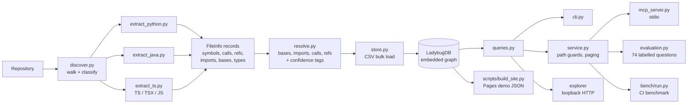

<p align="center"></p>

# codegraph

[](https://github.com/muhib-karim/codegraph/actions/workflows/ci.yml)
[](https://github.com/muhib-karim/codegraph/actions/workflows/codeql.yml)
[](https://muhib-karim.github.io/codegraph/)
[](CHANGELOG.md)


[](LICENSE)
[](#evaluation)
[](CITATION.cff)

**Website and live demo: [muhib-karim.github.io/codegraph](https://muhib-karim.github.io/codegraph/)** ·
Docs: [MCP setup](docs/MCP.md) · [Benchmark](bench/README.md) · [Design](DESIGN.md) ·
[Changelog](CHANGELOG.md) · [Contributing](CONTRIBUTING.md) · [Security](SECURITY.md)

codegraph answers structural questions about a Python, Java, TypeScript or
JavaScript codebase: where a symbol is defined, who calls it, what it calls,
what inherits from it, what looks unused and what a change might affect. It is
for developers and coding agents that need checkable evidence before they
rename, delete or refactor code. Every answer is a symbol identity plus a
`file:line` citation that you can open and verify.

Text search is the usual tool for these questions, and it is not enough. It
matches names in comments and in unrelated classes. It cannot follow an import
or tell two overloads apart. codegraph parses the code with Tree-sitter,
resolves names into an embedded graph database and answers with graph queries.
Each relationship carries a confidence tag. There is no LLM in the answer path.

[](https://muhib-karim.github.io/codegraph/)

*The [Pages demo](https://muhib-karim.github.io/codegraph/) runs in the browser
from a bundled index of this repository's test fixtures; no backend.*

| Question | CLI | MCP tool | Evidence |
|---|---|---|---|
| Which symbols match a name? | `search` | `search` | Declaration |
| Where is this symbol defined? | | `find_symbol` | Declaration |
| Who calls or references it? | `callers` | `callers` | Call or value-reference site |
| What does it call? | `callees` | `callees` | Call site, plus target declaration |
| What might a change affect? | `impact` (alias `blast`) | `impact` (alias `blast_radius`) | Reverse call, reference or inheritance site |
| Which classes inherit from it? | `inherits` | `inherits` | Class declaring the inheritance edge |
| What appears unused? | `dead-code` | `dead_code` | Candidate declaration |
| Is this snapshot current? | `stats` (stored metadata) | `index_status` (SHA-256 staleness) | File starts and coverage counts |

## Install

Use Python 3.11 or 3.12.

```sh
python3 -m venv .venv && . .venv/bin/activate
pip install "codegraph[mcp] @ git+https://github.com/muhib-karim/codegraph"
```

From a checkout, `pip install -e '.[dev,mcp]'` also installs the test and lint
tools. The core install does not need the MCP SDK. Indexing and queries never
execute repository source code.

## Usage

```sh
codegraph index path/to/repo               # writes path/to/repo/.codegraph/graph.lbug
codegraph search scale --repo path/to/repo
codegraph callers make --repo path/to/repo
codegraph callees main --repo path/to/repo
codegraph impact src/util.ts --repo path/to/repo --depth 2
codegraph inherits Shape --repo path/to/repo
codegraph dead-code --repo path/to/repo --confidence likely
codegraph explore --repo path/to/repo      # read-only loopback explorer
```

A captured session against the committed `mini` fixture, after indexing:

```text
$ codegraph callers make --repo tests/fixtures/mini
app.py:6	main	function	exact	1	app.py:5
app.py:10	main	function	exact	1	app.py:5
$ codegraph inherits Shape --repo tests/fixtures/mini
pkg/shapes.py:15	Circle	class	exact	1
pkg/shapes.py:23	Ring	class	exact	2
$ codegraph dead-code --repo tests/fixtures/mini --confidence likely
decoys.py:8	_unused_helper	function	likely
pkg/shapes.py:28	_orphan	function	likely
src/demo/Dog.java:5	Dog.unusedField	field	likely
src/demo/Dog.java:14	Dog.bark	method	likely
src/demo/Dog.java:16	Dog.neverCalled	method	likely
```

Each row is tab-separated: citation, symbol, kind, confidence, then traversal
depth where it applies. For `callers` and `impact` the last column is the
caller's own declaration; for `callees` it is the target's declaration.

Useful options:

- `--json` prints machine-readable output; `--db PATH` selects a custom database.
- A symbol can be a bare name, a qualified name, or a full `path::qualname/arity` ID.
- `--in FILE` picks the definition in one file when a name is ambiguous.
- `--scope PREFIX` keeps only results under a path prefix.

The exit code is 0 for a completed query, including an empty result. It is 2
for an unknown target and 1 for a database or operational error. The explorer
and MCP server read the database; indexing rebuilds it in place, so close them
before you re-index.

### Languages

| Language | Extensions | Resolved |
|---|---|---|
| Python | `.py` | scopes, imports, `self`/`super`, constructed locals and attributes, arity |
| Java | `.java` | packages, imports, declared types, overloads by arity, `this`/`super`, method references |
| TypeScript | `.ts` `.tsx` `.mts` `.cts` | ES imports, re-export barrels, default exports, classes, interfaces, enums, parameter properties, typed and constructed locals, JSX components |
| JavaScript | `.js` `.jsx` `.mjs` `.cjs` | ES imports, CommonJS `require`/`module.exports`, classes, arrow functions |

Relative JS/TS specifiers resolve in Node/TypeScript order (`./x` tries
`x.ts`, `x.tsx`, ... then `x/index.*`; `./x.js` also finds `x.ts`). Package
imports and `tsconfig` path aliases are treated as external.

## MCP server

Install the `mcp` extra and index your repository. Then add this JSON to the
configuration of an MCP-capable agent that supports stdio servers, replacing
the two absolute paths. The test suite parses this exact snippet and runs its
command through the official SDK client.

```json
{
  "mcpServers": {
    "codegraph": {
      "command": "/absolute/path/to/codegraph/.venv/bin/codegraph",
      "args": ["mcp", "--repo", "/absolute/path/to/repo"]
    }
  }
}
```

Claude Code:

```sh
claude mcp add codegraph -- /absolute/path/to/codegraph/.venv/bin/codegraph mcp --repo /absolute/path/to/repo
```

Codex CLI (`~/.codex/config.toml`):

```toml
[mcp_servers.codegraph]
command = "/absolute/path/to/codegraph/.venv/bin/codegraph"
args = ["mcp", "--repo", "/absolute/path/to/repo"]
```

[docs/MCP.md](docs/MCP.md) has the full tool reference. In short: the server
exposes `index_status`, `search`, `find_symbol`, `callers`, `callees`,
`impact`, `blast_radius`, `inherits` and `dead_code`, and opens the database
read-only. It offers no raw query language, no write operations and no way for
a client to choose a different repository. Path arguments must name indexed
paths inside the stored repository root; traversal, absolute paths and
symlinks that point outside are rejected with a tool error.

An agent should call `index_status` first. It reports parser coverage and
whether the snapshot is stale, by comparing SHA-256 content hashes and listing
added and deleted files. Responses include `results`, `total`, `truncated` and
`next_offset`; tools accept `limit` (1 to 100) and `offset`. Traversal depth is
1 to 10. Definitions have confidence `exact`; relationship results keep the
tag stored on the graph edge. An empty answer is an empty result list, never an
invented citation. Stdout carries only the protocol. See the
[MCP specification](https://modelcontextprotocol.io/specification).

## Architecture



Indexing runs in two passes. Pass 1 parses each file on its own and records
declarations, imports, base classes, call sites, value references and simple
type facts. Pass 2 sees the whole repository: it resolves bases first (so
inherited members can be found), then imports, calls and references, and tags
every edge `exact` or `heuristic` with a reason. Calls into the standard
library or third-party packages are counted, not stored. The graph schema is
unchanged since 1.0.0.

## Benchmark

The `benchmark` CI job clones three pinned public repositories, indexes each in
a fresh process and times the query paths the MCP server uses. The table is
copied unchanged from one CI run; see [bench/README.md](bench/README.md) for the
method and how to run it yourself.

Runner: GitHub Actions · ubuntu24 20261018.339.1 · Linux 7.0.0-1017-azure · x86_64 · 4 CPUs · Python 3.12.15. Date (UTC): 2026-10-22. codegraph 1.1.0, commit b3daafac4283, run 39707970318.

| Repository | Ref | Parsed files | Parsed LOC | Symbols | Edges | Index (s) | Peak RSS (MB) | callers | callees | impact | search |
|---|---|---:|---:|---:|---:|---:|---:|---:|---:|---:|---:|
| requests (Python) | `v2.32.3` | 36 | 11209 | 928 | 946 | 0.41 | 123.7 | 4.91 ms | 4.12 ms | 15.28 ms | 2.83 ms |
| zod (TypeScript) | `v3.23.8` | 170 | 30994 | 1717 | 7275 | 0.87 | 127.0 | 8.32 ms | 8.06 ms | 14.01 ms | 2.14 ms |
| gson (Java) | `gson-parent-2.11.0` | 249 | 53021 | 5757 | 27395 | 1.51 | 156.4 | 116.26 ms | 21.23 ms | 181.14 ms | 6.98 ms |

Query columns are medians of 20 runs after a warm-up, with limit 100. Targets
are chosen from each graph (the most-called function or method, and the
function with the most outgoing calls), not hand-picked. Numbers from other
machines are not comparable.

## Evaluation

```sh
codegraph eval
```

The command indexes the three labelled fixture repositories (`mini`,
`workflow` and the TypeScript/JavaScript `workflow_ts`) into temporary
databases. It then runs 74 hand-labelled questions through two retrievers, the
graph and a text-search baseline, and scores both. It writes
[a Markdown report](eval/reports/latest.md) and
[the full JSON evidence](eval/reports/latest.json). The report records the
exact command and SHA-256 hashes of the question file and every fixture file.
No network, external harness, browser or model is needed.

The questions cover callers, inheritance, unused candidates, change impact and
symbol lookup in Python (32 questions), Java (18), TypeScript (12) and
JavaScript (12). Labels follow the fixture source and the intended language
behavior. Some questions involve runtime
dispatch and same-arity overloads that the resolver cannot answer correctly;
they stay in the set and count as failures. Each expected answer has a symbol
ID and a `file:line` citation. [The label policy](eval/README.md) documents
the semantics, empty-answer conventions, confidence breakdowns and how to
extend the suite.

The baseline is whole-word text search. It borrows declaration spans from the
index only to map each hit to the same symbol IDs; it never reads resolved
edges. Matches in comments and strings count, which is what the decoys test.
It does no transitive traversal, type resolution or import binding. Both
retrievers get the same question arguments, and neither sees the expected
answers.

Actual overall results from `codegraph eval` (macro averages; hit@5):

| Retriever | Precision | Recall | F1 | MRR | hit@5 | Citation accuracy |
|---|---:|---:|---:|---:|---:|---:|
| Graph | 0.9054 | 0.8959 | 0.8904 | 0.9155 | 0.9155 | 0.9054 |
| Text baseline | 0.7658 | 0.8507 | 0.7588 | 0.8333 | 0.9577 | 0.7703 |

By language (F1 and citation accuracy; the report has every metric):

| Language | Questions | Graph F1 | Text F1 | Graph citation accuracy | Text citation accuracy |
|---|---:|---:|---:|---:|---:|
| Python | 32 | 0.9271 | 0.8187 | 0.9375 | 0.8021 |
| Java | 18 | 0.8704 | 0.7574 | 0.8889 | 0.7778 |
| TypeScript | 12 | 0.8796 | 0.5710 | 0.9167 | 0.6389 |
| JavaScript | 12 | 0.8333 | 0.7889 | 0.8333 | 0.8056 |

How to read the table:

- Precision, recall and F1 compare distinct symbol IDs.
- MRR and hit@5 use the first relevant result in the tool's deterministic
  output order (file and line, with `likely` dead-code candidates first). There
  is no learned relevance score.
- Citation accuracy is the share of returned `(symbol, file, line)` tuples that
  match a labelled tuple.
- MRR and hit@5 read the same ranked list per question, so they match
  whenever the first relevant result is either ranked first or missing from
  the top 5. That is why the graph row shows 0.9155 for both.
- Three questions have an empty expected answer. They are excluded from MRR
  and hit@5.

The baseline has the higher hit@5 because it returns broader matches. The graph
returns fewer decoys but misses edges that only exist at runtime. These are
results on small fixtures written for this project. They are not a claim about
performance on arbitrary repositories.

## Design decisions

- **No LLM in answers.** Every result traces back to a stored declaration or
  edge. Queries are deterministic, so the evaluation is reproducible.
- **Confidence tags are part of the evidence.** `exact` means a static binding
  under the resolver's rules; it does not prove the runtime target. `heuristic`
  marks unique-name guesses, arity mismatches and ambiguous overloads. The
  dead-code tags `likely` and `possible` classify candidates. Neither means a
  symbol is safe to delete.
- **Embedded graph database.** Typed relationships and reverse traversal work
  without a database server. LadybugDB stores the snapshot locally. The process
  uses a 64 MiB buffer pool and two database worker threads; this is not a cap
  on total memory.
- **Small dependency surface.** The parser adapters, resolver, queries and
  explorer live in this repository. Tree-sitter, the database and the optional
  MCP SDK are ordinary dependencies.
- **One binding model for dynamic languages.** TypeScript and JavaScript
  imports (ES modules, CommonJS `require`, default exports and re-export
  barrels) are mapped onto the same lexical binding path the resolver uses for
  Python, so all four languages answer the same questions the same way.

[DESIGN.md](DESIGN.md) records the original contracts, and
[the v1 addendum](docs/DESIGN-v1.md) describes the interfaces added in 1.0.0.
[docs/MCP.md](docs/MCP.md) covers MCP client setup.
The other files in `docs/` are historical design notes. Some refer to external
evaluation artifacts that are not part of this repository.

## Limitations

- Reflection, framework registration, dynamic attributes and runtime dispatch
  are only partly handled. In JS/TS, receivers whose type comes from a call
  result or a library are matched by unique name (`heuristic`) or not at all.
- Java overloads are resolved by arity, not by argument types. JavaScript calls
  are not arity-checked, because the language allows any argument count;
  TypeScript calls are checked against declared parameters.
- TypeScript `tsconfig` path aliases, package `exports` maps and calls across
  language boundaries are not resolved.
- A bare name prefers an exact qualified-name match, so a top-level function
  can hide methods with the same name. Use a qualified name or full ID instead.
- A dead-code result is an unused candidate under local analysis. It is not
  proof that the code is unreachable. Exported JS/TS symbols are `possible`.
- The evaluation fixtures are small and were written for this project. They
  are not an independent benchmark.
- The snapshot is rebuilt in place, so indexing must not run while the
  explorer or MCP server is reading it.
- The explorer and the freshness checks assume a trusted local repository.
- On syntactically invalid files, parser recovery can keep partial symbols.

## Roadmap

1. `tsconfig` paths and package `exports` resolution for monorepos.
2. Overload resolution by argument type, and explicit candidate sets for
   dynamic dispatch.
3. Atomic snapshot replacement so readers never see a half-written index.
4. Pagination inside the database, and evaluation on larger, independently
   labelled repositories.

New languages should come with their own fixtures, query-level tests and
citation conventions.

## Tech stack

- **Language:** Python
- **Frameworks and tools:** Playwright, pytest, Ruff, mypy, Docker
- **CI:** GitHub Actions

## Contributing

Issues and pull requests are welcome. See [CONTRIBUTING.md](CONTRIBUTING.md) for the workflow. Before opening a pull request, run `pytest`. Please keep each pull request focused and say how you tested it.

## License

See [LICENSE](LICENSE).

## Citation

If you use codegraph or its evaluation set, please cite it (GitHub's "Cite this repository"
button reads [`CITATION.cff`](CITATION.cff)):

```bibtex
@software{karim_codegraph_2026,
  author  = {Karim, Muhib},
  title   = {codegraph: a cited code-structure index for Python, Java and TypeScript/JavaScript, with a labelled retrieval evaluation},
  year    = {2026},
  version = {1.1.0},
  url     = {https://github.com/muhib-karim/codegraph}
}
```

## Development and container

```sh
make install                      # venv + editable install with dev and MCP extras
make lint typecheck test eval     # ruff, mypy --strict, pytest (coverage >= 85%), evaluation
python bench/run.py --local tests/fixtures/web --out /tmp/bench
python scripts/build_site.py --out _site
docker build -t codegraph:1.1.0 .
docker run --rm -v "$PWD/tests/fixtures/mini:/repo" codegraph:1.1.0 index /repo
docker run --rm -v "$PWD/tests/fixtures/mini:/repo:ro" codegraph:1.1.0 callers make --repo /repo
```

The container runs as UID 10001. For indexing, the mounted repository must be
writable by that user, or pass `--user "$(id -u):$(id -g)"`. To run the MCP
server in a container, use `docker run -i` without a TTY.

CI runs on Python 3.11 and 3.12: ruff lint and format, mypy strict over the
package and scripts, tests with at least 85% package coverage, the evaluation
(the committed report must match), gitleaks, CodeQL for Python,
JavaScript/TypeScript and workflows, a container build with a non-root smoke
test, and the benchmark. Dependabot watches pip, Actions and Docker updates.
Browser tests are optional and skip when no browser is installed.

See [CONTRIBUTING.md](CONTRIBUTING.md), [SECURITY.md](SECURITY.md) and
[CHANGELOG.md](CHANGELOG.md). License: [MIT](LICENSE).
