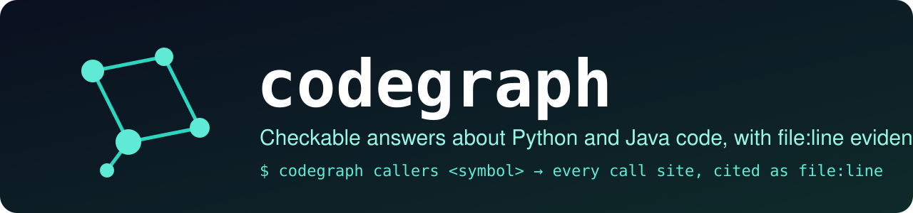
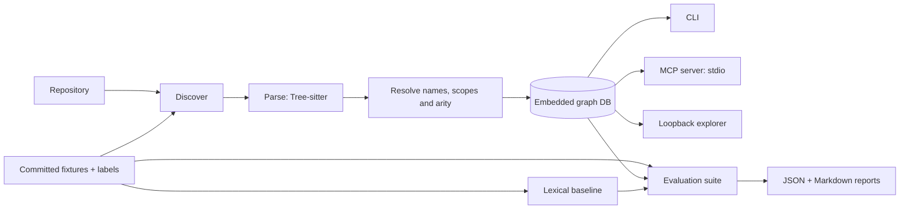

<p align="center"></p>

# codegraph

[](https://github.com/muhib-karim/codegraph/actions/workflows/ci.yml)
[](https://github.com/muhib-karim/codegraph/releases/latest)


[](LICENSE)
[](#evaluation)
[](CITATION.cff)

Docs: [Design](DESIGN.md) · [Changelog](CHANGELOG.md) · [Contributing](CONTRIBUTING.md) · [Security](SECURITY.md)

codegraph answers structural questions about a Python or Java codebase: where a
symbol is defined, who calls it, what inherits from it, what looks unused and
what a change might affect. It is for developers and coding agents that need
checkable evidence before they rename, delete or refactor code. Every answer is
a symbol identity plus a `file:line` citation that you can open and verify.

Text search is the usual tool for these questions, and it is not enough. It
matches names in comments and in unrelated classes. It cannot follow an import
or tell two overloads apart. codegraph parses the code with Tree-sitter,
resolves names into an embedded graph database and answers with graph queries.
Each relationship carries a confidence tag. There is no LLM in the answer path.

| Question | Interface | Evidence |
|---|---|---|
| Where is this symbol defined? | MCP `find_symbol` | Declaration |
| Who calls or references it? | CLI `callers`, MCP `callers` | Call or value-reference site |
| What does it call? | MCP `callees` | Call site, plus target declaration |
| Which classes inherit from it? | CLI / MCP `inherits` | Class declaring the inheritance edge |
| What appears unused? | CLI `dead-code`, MCP `dead_code` | Candidate declaration |
| What might a change affect? | CLI `blast`, MCP `blast_radius` | Reverse call, reference or inheritance site |
| Is this snapshot current? | MCP `index_status`; CLI `stats` for stored metadata | File starts and coverage counts |

The local explorer (`codegraph explore`) browses the same snapshot in a
browser, with source previews and a bounded graph view. Indexing rebuilds the
database in place, so close the explorer and any MCP server before you
re-index.



## Quickstart

Use Python 3.11 or 3.12. From this checkout:

```sh
python3 -m venv .venv
. .venv/bin/activate
pip install -e '.[dev,mcp]'
codegraph index tests/fixtures/mini
codegraph callers make --repo tests/fixtures/mini
codegraph inherits Shape --repo tests/fixtures/mini
codegraph dead-code --repo tests/fixtures/mini --confidence likely
codegraph blast SCALE --repo tests/fixtures/mini --depth 2 --json
codegraph explore --repo tests/fixtures/mini --port 8765
```

A captured session against the committed `mini` fixture, after indexing:

```text
$ codegraph callers make --repo tests/fixtures/mini
app.py:6	main	function	exact	1	app.py:5
app.py:10	main	function	exact	1	app.py:5
$ codegraph inherits Shape --repo tests/fixtures/mini
pkg/shapes.py:15	Circle	class	exact	1
pkg/shapes.py:23	Ring	class	exact	2
$ codegraph dead-code --repo tests/fixtures/mini --confidence likely
decoys.py:8	_unused_helper	function	likely
pkg/shapes.py:28	_orphan	function	likely
src/demo/Dog.java:5	Dog.unusedField	field	likely
src/demo/Dog.java:14	Dog.bark	method	likely
src/demo/Dog.java:16	Dog.neverCalled	method	likely
```

Each row is tab-separated: citation, symbol, kind, confidence, then traversal
depth where it applies. For `callers`, the last column is the caller's own
declaration.

Useful options:

- `--db PATH` selects a custom database.
- A symbol can be given as a bare name, a qualified name, or a full
  `path::qualname/arity` ID.
- `--in FILE` picks the definition in one file when a name is ambiguous.
- `--scope PREFIX` keeps only results under a path prefix.

CLI JSON output keeps the v0.1 contract. The exit code is 0 for a completed
query, including an empty result. It is 2 for an unknown target and 1 for a
database or operational error.

The core install (`pip install .`) does not need the MCP SDK. Indexing and
queries never execute repository source code.

## MCP setup

Install the `mcp` extra (`pip install '.[mcp]'`) and index your repository.
Then add this JSON to the configuration of an MCP-capable agent that supports
stdio servers, replacing the two absolute paths. The test suite parses this
exact snippet and runs its command through the official SDK client.

```json
{
  "mcpServers": {
    "codegraph": {
      "command": "/absolute/path/to/codegraph/.venv/bin/codegraph",
      "args": ["mcp", "--repo", "/absolute/path/to/repo"]
    }
  }
}
```

For a database in a custom location, use
`codegraph mcp --db /absolute/path/to/graph.lbug`.

The server exposes the seven tools listed above and opens the database
read-only. It offers no raw Cypher, no write operations and no way for a client
to choose a different repository. Every path argument must name an indexed
path inside the stored repository root. Path traversal (`..`), absolute paths
and symlinks that point outside the repository are rejected with a tool error.

An agent should call `index_status` first. It reports parser coverage and
whether the snapshot is stale. Staleness is detected by comparing SHA-256
content hashes and by listing added and deleted files. Indexes built before
1.0.0 have no hashes, so their freshness is reported as unknown until rebuilt.
File-status rows cite line 1 of each file as an anchor, with confidence
`not_applicable`. They are metadata, not evidence of a relationship.

Definitions from `find_symbol` have confidence `exact` and reason `definition`.
Relationship results keep the confidence tag stored on the graph edge. An
empty answer is an empty result list, never an invented citation.

Responses include `results`, `total`, `truncated` and `next_offset`. Tools
accept `limit` (1 to 100) and `offset`; pass `next_offset` back to get the next
page. Traversal depth is 1 to 10. It defaults to 1 for callers and to 3 for
inheritance and blast radius. `callees` returns direct calls only. Paging limits
the response size, not the database work, because results are materialized
before paging. Errors are returned as MCP tool errors. Stdout carries only the
protocol. See the [MCP specification](https://modelcontextprotocol.io/specification).

## Evaluation

```sh
codegraph eval
```

The command indexes both committed fixture repositories into temporary
databases. It then runs 50 hand-labelled questions through two retrievers, the
graph and a text-search baseline, and scores both. It writes
[a Markdown report](eval/reports/latest.md) and
[the full JSON evidence](eval/reports/latest.json). The report records the
exact command and SHA-256 hashes of the question file and every fixture file.
No network, external harness, browser or model is needed.

The questions cover callers, inheritance, unused candidates, change impact and
symbol lookup. Labels follow the fixture source and the intended language
behavior. Some questions involve runtime
dispatch and same-arity overloads that the resolver cannot answer correctly;
they stay in the set and count as failures. Each expected answer has a symbol
ID and a `file:line` citation. [The label policy](eval/README.md) documents
the semantics, empty-answer conventions, confidence breakdowns and how to
extend the suite.

The baseline is whole-word text search. It borrows declaration spans from the
index only to map each hit to the same symbol IDs; it never reads resolved
edges. Matches in comments and strings count, which is what the decoys test.
It does no transitive traversal, type resolution or import binding. Both
retrievers get the same question arguments, and neither sees the expected
answers.

Actual overall results from `codegraph eval` (macro averages; hit@5):

| Retriever | Precision | Recall | F1 | MRR | hit@5 | Citation accuracy |
|---|---:|---:|---:|---:|---:|---:|
| Graph | 0.9200 | 0.9200 | 0.9067 | 0.9362 | 0.9362 | 0.9200 |
| Text baseline | 0.7867 | 0.9067 | 0.7967 | 0.8546 | 1.0000 | 0.7933 |

How to read the table:

- Precision, recall and F1 compare distinct symbol IDs.
- MRR and hit@5 use the first relevant result in the tool's deterministic
  output order (file and line, with `likely` dead-code candidates first). There
  is no learned relevance score.
- Citation accuracy is the share of returned `(symbol, file, line)` tuples that
  match a labelled tuple.
- MRR and hit@5 read the same ranked list per question, so they match
  whenever the first relevant result is either ranked first or missing from
  the top 5. That is why the graph row shows 0.9362 for both.
- Three questions have an empty expected answer. They are excluded from MRR
  and hit@5.

The baseline has the higher hit@5 because it returns broader matches. The graph
returns fewer decoys but misses edges that only exist at runtime. These are
results on small fixtures written for this project. They are not a claim about
performance on arbitrary repositories.

## Design decisions

- **No LLM in answers.** Every result traces back to a stored declaration or
  edge. Queries are deterministic, so the evaluation is reproducible.
- **Confidence tags are part of the evidence.** `exact` means a static binding
  under the resolver's rules; it does not prove the runtime target. `heuristic`
  marks unique-name guesses, arity mismatches and ambiguous overloads. The
  dead-code tags `likely` and `possible` classify candidates. Neither means a
  symbol is safe to delete.
- **Embedded graph database.** Typed relationships and reverse traversal work
  without a database server. LadybugDB stores the snapshot locally. The process
  uses a 64 MiB buffer pool and two database worker threads; this is not a cap
  on total memory.
- **Small dependency surface.** The parser adapters, resolver, queries and
  explorer live in this repository. Tree-sitter, the database and the optional
  MCP SDK are ordinary dependencies.

[DESIGN.md](DESIGN.md) records the original contracts, and
[the v1 addendum](docs/DESIGN-v1.md) describes the interfaces added in 1.0.0.
The other files in `docs/` are historical design notes. Some refer to external
evaluation artifacts that are not part of this repository.

## Limitations and roadmap

Limitations:

- Only Python and Java produce symbols. Files in other languages are recorded
  as coverage gaps, and there are no cross-language edges.
- Reflection, framework registration, dynamic attributes and runtime dispatch
  are only partly handled.
- Java overloads are resolved by arity, not by argument types.
- A bare name prefers an exact qualified-name match, so a top-level function
  can hide methods with the same name. Use a qualified name or full ID instead.
- A dead-code result is an unused candidate under local analysis. It is not
  proof that the code is unreachable.
- The evaluation fixtures are small and were written for this project. They
  are not an independent benchmark.
- The snapshot is rebuilt in place, so indexing must not run while the
  explorer or MCP server is reading it.
- The explorer and the freshness checks assume a trusted local repository.
  Path checks do not stop a local process that swaps files while they run.
- On syntactically invalid files, parser recovery can keep partial symbols.

Roadmap, in order: overload resolution by argument type, explicit candidate
sets for dynamic dispatch, atomic snapshot replacement, pagination inside the
database, and evaluation on larger, independently labelled repositories. New
languages should come with their own fixtures and citation conventions.

## Citation

If you use codegraph or its evaluation set, please cite it (GitHub's "Cite this repository"
button reads [`CITATION.cff`](CITATION.cff)):

```bibtex
@software{karim_codegraph_2026,
  author  = {Karim, Muhib},
  title   = {codegraph: a cited code-structure index for Python and Java, with a labelled retrieval evaluation},
  year    = {2026},
  version = {1.0.0},
  url     = {https://github.com/muhib-karim/codegraph}
}
```

## Development and container

```sh
make lint typecheck test eval
make demo
# Build and run with a writable repository mount for indexing:
docker build -t codegraph:1.0.0 .
docker run --rm -v "$PWD/tests/fixtures/mini:/repo" codegraph:1.0.0 index /repo
docker run --rm -v "$PWD/tests/fixtures/mini:/repo:ro" codegraph:1.0.0 callers make --repo /repo
```

The container runs as UID 10001. For indexing, the mounted repository must be
writable by that user, or pass `--user "$(id -u):$(id -g)"`. To run the MCP
server in a container, use `docker run -i` without a TTY.

CI runs on Python 3.11 and 3.12. It checks lint and formatting, strict types on
the new modules and package coverage of at least 85%. It also regenerates the
evaluation report and fails if the committed report differs, and it builds the
container and runs a smoke test. Browser tests are optional and skip when no
browser is installed.

See [CONTRIBUTING.md](CONTRIBUTING.md), [SECURITY.md](SECURITY.md) and
[CHANGELOG.md](CHANGELOG.md). License: [MIT](LICENSE).
